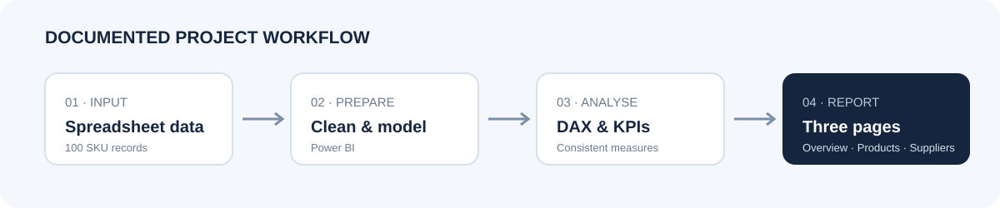
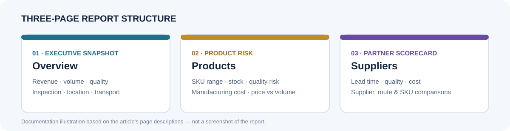
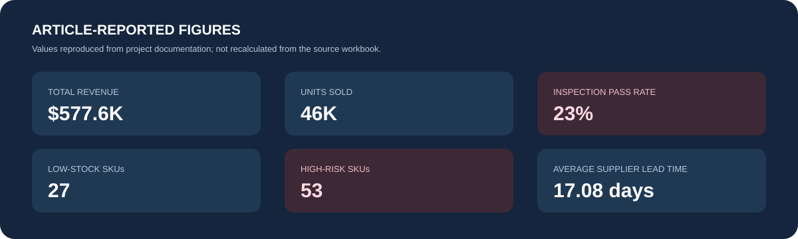

# Carvex Logistics Supply Chain Performance Dashboard

> **Power BI · Supply Chain Analytics · Product Performance · Quality · Supplier Scorecard**

A three-page Power BI dashboard documented by [Adeyemi Adenuga](https://medium.com/@adeyemi.da/carvex-logistics-supply-chain-performance-dashboard-2610ac31b8fd). The report brings revenue, inspection quality, inventory exposure, product performance and supplier operations into an executive Overview, Products and Suppliers experience.



[](https://www.microsoft.com/power-platform/products/power-bi) [](https://learn.microsoft.com/dax/) [](https://medium.com/@adeyemi.da/carvex-logistics-supply-chain-performance-dashboard-2610ac31b8fd)

## Table of Contents

- [Project Overview](#project-overview)
- [Objectives](#objectives)
- [Dataset](#dataset)
- [Data Cleaning](#data-cleaning)
- [Analysis](#analysis)
- [Dashboard Structure](#dashboard-structure)
- [Key Insights](#key-insights)
- [Recommendations](#recommendations)
- [Tools Used](#tools-used)
- [Project Files](#project-files)
- [Conclusion](#conclusion)
- [Source](#source)

## Project Overview

Carvex Logistics had supply-chain information spread across a spreadsheet, making it difficult to see how revenue, quality, stock, suppliers and shipping costs fit together. The project documented in the article converts that data into a three-page Power BI report designed to make performance, risk and opportunity easier to review, with drill-down into underlying detail.

The report is described as a snapshot: the source has no date dimension, so month-over-month comparisons are not available. The author proposes adding order dates before introducing time-based monitoring.

## Objectives

The dashboard was designed to help users assess:

- Revenue, sales volume and product-line contribution.
- Inspection outcomes, pass rate and defect levels.
- Stock position, low-stock SKUs and higher-risk products.
- Manufacturing and logistics costs.
- Supplier lead time, quality and commercial contribution.
- Revenue and volume by location, route and transport mode.

## Dataset

The article describes a spreadsheet with **100 product/SKU records** across **skincare, haircare and cosmetics**. Each record represents one SKU. Fields named in the article include price, units sold, revenue, stock levels, manufacturing costs, lead time, shipping costs, shipping carrier, supplier name and location, inspection result, defect rate, transportation mode and route.

The article does not provide the source workbook, a field-by-field schema, or a dataset download. No dataset is included in this repository folder.

## Data Cleaning

The article says the data was cleaned and modelled in Power BI so measures would calculate consistently and filters would work across report pages. It does not specify individual cleaning steps, removed records, missing-value rules, data types, or model relationships. Those details are therefore not inferred here.

The documented model uses a table named `Supply Chain`. Its columns are referenced in the DAX measures linked below. The article notes that there is no date dimension; the example previous-period measure is a placeholder and the month-over-month measure is blank.

## Analysis

The documented DAX measures cover sales volume and revenue, distinct SKUs, average selling price, inspection counts and pass rate, average defect rate, average stock, low-stock SKUs, shipping and logistics costs, revenue and volume slices by location or carrier, revenue per unit, an estimated defect-cost proxy, high-risk SKUs, supplier count, lead time and manufacturing cost.

The full measures as presented in the article are preserved in [`PowerBI/DAX_Measures.md`](PowerBI/DAX_Measures.md). The article also says conditional formatting highlights the low 23% inspection pass rate in red. Two comparison measures are explicitly marked as placeholders because the source has no date dimension.

## Dashboard Structure

### Overview — Executive Performance Snapshot

The opening page addresses revenue and volume, quality status, customer-group and product-line contribution, revenue by inspection outcome, and the value carried by transport modes and locations.

### Products — Product Performance & Risk

The product page focuses on active range and average selling price, low-stock and high-risk SKUs, manufacturing effort and cost, volume/cost/lead-time trade-offs, and product price-versus-volume positions.

### Suppliers — Supplier Performance Scorecard

The supplier page compares the five suppliers on reliability, lead time, route and supplier revenue or volume, quality results, costs, and SKUs needing attention.

The image below is a **documentation illustration of the three-page structure**, not a screenshot of the Power BI report.



## Key Insights

The following figures and observations are reported in the source article. The accompanying image is a compact summary of those reported figures, not a screenshot or a recalculation from the source workbook.



### Overview

- Revenue is reported as **$577.6K** from **46K units sold**.
- Inspection outcomes are reported as **23% passed, 36% failed and 41% pending**; the average defect rate is **2.3**.
- Pending and failed items generate more revenue than passed items.
- Mumbai and Kolkata are the top-performing locations in the article's account.
- Rail, road and air carry most of the value; sea contributes less. Inventory is described as approximately **5K units**.

### Products

- The portfolio contains **100 active SKUs**, with an average selling price of **$49.5**.
- **27 SKUs** are identified as low stock and **53** as high risk.
- Haircare leads production volume; Skincare has the highest average manufacturing cost.
- Stock is described as fairly evenly spread across categories, with Haircare holding the largest share. The price-volume scatter shows a wide spread.

### Suppliers

- The business works with **5 suppliers** and the average lead time is reported as **17.08 days**.
- Supplier 1 and Supplier 2 contribute the highest volume; Supplier 4 has the highest average manufacturing cost.
- Route B generates the largest share of revenue.
- The article reports an estimated defect cost exposure of **$1.32M**. It describes this as an estimate/proxy, not a directly observed cost.

## Recommendations

The article recommends prioritising quality review of high-revenue and high-defect SKUs, using the supplier scorecard to focus supplier discussions, and linking replenishment rules to the 27 low-stock SKUs. It also recommends adding order dates so month-over-month movement and lead-time trends can be monitored over time.

## Tools Used

- **Microsoft Power BI** for data modelling and the three-page dashboard.
- **DAX** for the documented measures.
- **Spreadsheet source data** as described in the article; the source file and its application are not specified.

## Project Files

```text
Carvex-Logistics-Supply-Chain-Performance/
├── README.md
├── Images/
│   ├── dashboard-structure.svg
│   ├── project-workflow.svg
│   └── reported-kpis.svg
└── PowerBI/
    └── DAX_Measures.md
```

The source article does **not** provide an accessible `.pbix`/`.pbip` file, the source dataset, dashboard screenshots, or a working interactive-report URL. This repository includes the actual DAX transcribed from the article and clearly labelled explanatory illustrations; it does not substitute a fabricated Power BI file or screenshots. The report file can be added to `PowerBI/` when the original project is available.

## Conclusion

The documented Carvex dashboard brings sales, quality, inventory, product and supplier performance into a shared three-page view. The reported results point especially to inspection quality and SKU risk as areas for attention, while the article identifies supplier-level comparisons and better date coverage as practical next steps.

## Source

All project-specific descriptions, measures and reported findings above are based on the original article: [Carvex Logistics Supply Chain Performance Dashboard — Adeyemi Adenuga](https://medium.com/@adeyemi.da/carvex-logistics-supply-chain-performance-dashboard-2610ac31b8fd).
